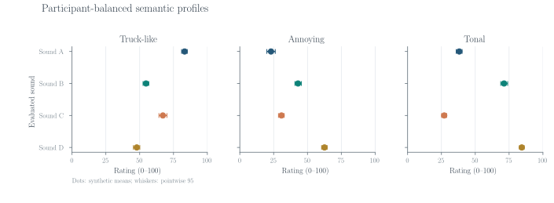
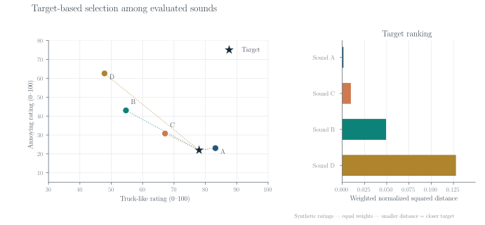
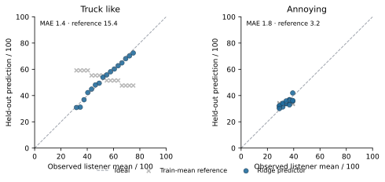

# SemanticAVAS

**Listener-based semantic analysis, target matching and WAV-to-semantic prediction for vehicle warning sounds.**

SemanticAVAS groups perceptual ratings by listener and evaluated sound, builds profiles on named semantic scales, and compares those profiles with a user-defined target. The package also includes sound-prototype synthesis and a regression workflow that learns acoustic-to-semantic mappings from paired recordings and listener ratings. Catalogue ranking and prediction use separate evaluation workflows.

**Research software preview · v0.9.0 · Python 3.10–3.13 · MIT**

## Example: from ratings to a sound choice



*Synthetic ratings from 18 simulated listeners. Points show listener-balanced means; whiskers show bootstrap intervals.*



*Four synthetic sound profiles ranked against a two-scale target using a normalized weighted distance.*

Both plots are calculated with [`SemanticAtlas`](src/semanticavas/core.py). Regenerate them with `python examples/make_readme_figures.py`.

## Install and check the package

From the repository root:

```bash
python -m pip install -e .
python examples/quickstart.py
```

The example assembles a small synthetic rating table, ranks its sounds and generates a digital waveform. To run the tests:

```bash
python -m pip install -e ".[dev]"
python -m pytest -q
```

## Work with your own ratings

CSV and NumPy input are supported. The JSON schema specifies rating scales, range, direction, and the participant/stimulus identifier columns.

```bash
semanticavas convert examples/step3_user_data/ratings_wide.csv \
  --schema examples/step3_user_data/schema.json \
  --output-dir example_import

semanticavas rank example_import/ratings.csv \
  --target '{"truck_like":70,"annoying":20}' \
  --scale-ranges '{"truck_like":100,"annoying":100}' \
  --output example_ranking.csv
```

The first command creates a normalized ratings table, a coverage report and a conversion manifest. The second compares the already-evaluated sounds with an illustrative target. [Data import](docs/USER_DATA_IMPORT.md) explains wide and long tables, repeated trials, missing ratings and NPZ inputs.

## The target-matching rule

For stimulus $i$ and semantic dimension $k$, `SemanticAtlas.rank` uses

$$
L_i=\frac{\displaystyle\sum_k w_k\left(\frac{\bar{s}_{ik}-t_k}{r_k}\right)^2}{\displaystyle\sum_k w_k},
$$

where $\bar{s}_{ik}$ denotes the participant-balanced mean rating, $t_k$ the target, $r_k$ the declared scale width and $w_k$ a nonnegative weight. Smaller $L_i$ indicates a closer match within the evaluated catalogue. Bootstrap intervals resample listeners.

Keep the original scale definition for each questionnaire. Cross-study comparisons require an explicit mapping between constructs and rating ranges.

## What is included

- Aggregation of listener ratings and uncertainty summaries.
- Ranking of previously rated sounds and sensitivity to target weights.
- Digital harmonic/noise prototype generation and optional data-analysis adapters.
- WAV-based prediction from listener-scored training sounds, with nested held-out evaluation.
- CSV/NPZ import with explicit scale and identifier checks.

The repository includes generated rating tables and signal examples. For measured listener responses and audio stimuli, use the respective dataset releases and cite their sources. See [Research notes](docs/RESEARCH_NOTES.md) and [FAQ](docs/FAQ.md).

## Reproduce the figures

```bash
python examples/make_readme_figures.py
# Optional LaTeX typesetting, if TeX is installed:
python examples/make_readme_figures.py --latex
```

The script generates both SVGs in `docs/figures/` using its bundled synthetic inputs.

## Citation and license

Software citation: [`CITATION.cff`](CITATION.cff). Code license: [`LICENSE`](LICENSE). Please cite original experimental datasets separately.

## Predict semantic ratings for an unseen WAV

SemanticAVAS can fit a multi-output ridge regression model from sound recordings paired with participant ratings. The predictor uses ten digital-audio descriptors and participant-balanced mean ratings. Model selection and evaluation hold out complete sounds; when `sound_family` is supplied, all sounds from the same family are held out together.

Generate a complete working example with synthetic sounds and rating tables:

```bash
python examples/prediction_demo.py --output-dir prediction_demo_output
```

To train on your own recordings, prepare `manifest.csv` with `stimulus,wav,sound_family` and `ratings.csv` with `participant,stimulus` followed by 0–100 semantic rating columns. WAV paths are interpreted relative to the manifest.

```bash
semanticavas train-predictor \
  --manifest manifest.csv --ratings ratings.csv \
  --scales truck_like annoying \
  --output-dir trained_model

semanticavas predict-wav \
  --model trained_model/semantic_model.npz new_avas.wav \
  --output predictions.csv
```



*Synthetic demonstration (16 generated sounds, four held-out sound families). Points compare observed listener means and predictions against a training-mean reference. Reproduce with `python examples/prediction_demo.py` followed by `python examples/plot_prediction_validation.py --table prediction_demo_output/heldout_predictions.csv`.*

Training produces `semantic_model.npz`, `heldout_predictions.csv`, `audio_summary.csv`, and `validation.json`. Prediction reports the estimated rating on each named scale, whether a descriptor exceeds the observed training range, and its distance to the nearest training sound in standardized feature space. The validation report compares held-out mean absolute error against the training-mean baseline and records the 90th-percentile absolute error observed across held-out sounds.

See [WAV prediction](docs/WAV_PREDICTION.md) for data layouts, examples, model interpretation and Python use. The training WAVs and questionnaire scales determine the application domain of the fitted model.
